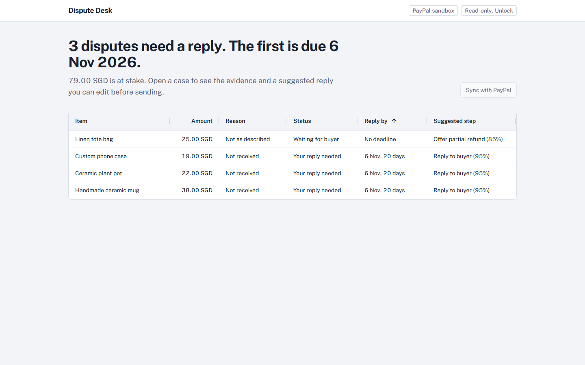
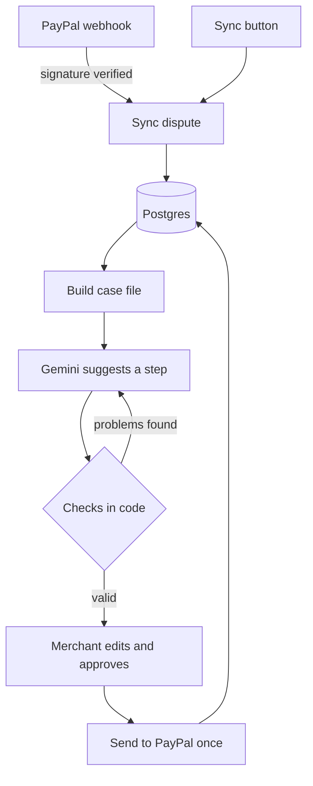

# Dispute Desk

A PayPal disputes copilot for small online shops.

When a buyer opens a dispute, Dispute Desk pulls everything PayPal knows about it into one case file, asks an AI model for the best next step, checks that answer in code, and lets the merchant edit and approve it before anything is sent back to PayPal. The aim is to settle disputes early, at the inquiry stage, before they turn into claims that PayPal decides.

**Live demo:** https://dispute-desk-nine.vercel.app (PayPal sandbox)



## Try it

1. Open the live demo. It starts read-only, so you can open any dispute and read its case file and suggestion.
2. Click a citation chip like `F10` or `M1` next to a reason. The page scrolls to that fact in the case file and highlights it.
3. Sending is locked on the public demo, so visitors can't change the sandbox disputes. To try the whole flow (sync, new suggestions, editing and sending), [run it locally](#run-it-locally) with your own PayPal sandbox app and operator key.

Everything runs against the PayPal sandbox. No real money moves.

## What it does

- **Queue.** Every dispute in one AG Grid table, most urgent reply deadline first, with its status, days left and the suggested step, or what has already been sent. You can search by item, reason or dispute ID.
- **Case file.** For each dispute it follows dispute, then capture, then order to find what was bought, when it was paid, the tracking number and the buyer's messages. Every fact gets a number (F1, F2, M1...) and a note of where it came from.
- **Suggestion.** An AI model reads only the case file and picks one of four steps: reply to the buyer, offer a partial refund, send tracking to PayPal, or accept and refund. Every reason it gives has to cite a fact.
- **Human approval.** The merchant can edit the reply and the offer amount. The button says exactly what will happen, for example "Send offer of 10.00 SGD". Nothing goes to PayPal until it's pressed.
- **History.** Every action sent to PayPal is logged with its status and request ID.

## How it works



### The model suggests, code decides

The AI is never trusted on its own. After it answers, code checks that:

- every reason cites a fact that really exists in the case file
- it only suggests sending tracking if there is a tracking number
- a partial refund is above zero and below the disputed amount
- the reply doesn't claim the item has shipped or will arrive when the case file has no tracking

If any check fails, the problems are sent back to the model and it tries again, up to three times. Details only the merchant knows, like a ship date, come back as `[placeholders]`, and the send button stays disabled until they're filled in. Buyer messages are treated as evidence, not instructions, so text like "ignore your rules" in a message doesn't change what the model does.

### Sending to PayPal safely

All sends go through one function, `approveRecommendation` in `src/lib/actions.ts`:

- It asks PayPal which actions are allowed on the dispute right now, using the links in the dispute details, and refuses anything else.
- Each send has an idempotency key (`PayPal-Request-Id`) stored with a unique constraint in the database. A double click or a retry can't send the same offer twice.
- Webhooks are verified with PayPal's signature API before anything is stored, and each event is processed only once.
- The live demo is read-only for visitors. An operator key unlocks sending, and every server action checks it on the server, because hiding a button isn't enough.

## PayPal APIs used

| API | What for |
| --- | --- |
| OAuth 2.0 client credentials | Access token, cached until shortly before it expires |
| Disputes: list, show details | Sync disputes and read which actions are allowed |
| Disputes: send message, make offer, accept claim, provide evidence | The four steps a merchant can approve |
| Payments v2: show captured payment | Link a dispute to its order |
| Orders v2: show order, add tracking | Item, amount and tracking for the case file |
| Webhooks: verify signature | Trust only real PayPal events |
| Webhook events | `CUSTOMER.DISPUTE.CREATED`, `UPDATED`, `RESOLVED` |

## Tech stack

- Next.js 16 (App Router, server actions), React 19, TypeScript, Tailwind CSS 4
- AG Grid for the dispute queue
- Prisma 7 with Neon Postgres
- Vercel AI SDK with Google Gemini (`gemini-3.8-flash`), structured output checked with Zod
- Hosted on Vercel

## Run it locally

You need Node 20 or later, a PayPal developer account with a sandbox app, a Postgres database (Neon's free tier works) and a Gemini API key from Google AI Studio.

```bash
git clone https://github.com/anishonly121/dispute-desk.git
cd dispute-desk
npm install
```

Create a `.env` file:

```bash
DATABASE_URL="postgresql://..."
PAYPAL_CLIENT_ID="..."
PAYPAL_CLIENT_SECRET="..."
PAYPAL_API_BASE="https://api-m.sandbox.paypal.com"
PAYPAL_WEBHOOK_ID="..."   # from your sandbox app's webhook settings
GOOGLE_GENERATIVE_AI_API_KEY="..."
OPERATOR_KEY="..."        # any long random string
```

Set up the database and start the app:

```bash
npx prisma migrate deploy
npm run dev
```

Open http://localhost:3000, unlock with your operator key and press **Sync with PayPal**.

### Making test disputes

```bash
# create a sandbox order, pay for it as the sandbox buyer, then capture it
node --env-file=.env scripts/seed-purchase.mjs buy "Ceramic plant pot" 22.00
```

Then log in to the sandbox buyer account at sandbox.paypal.com and open a dispute on that payment. It arrives through the webhook, or press Sync.

Other helper scripts in `scripts/` run with `npx tsx --env-file=.env scripts/<name>.ts`, for example `recommend.ts` to get suggestions from the command line.

## Tests

```bash
npm test
```

The tests cover the parts that keep the AI honest and the sends safe: the checks on every AI answer (citations, offer limits, tracking, invented shipping claims), building the case file from PayPal data, reading which actions PayPal allows, and the operator key. They use Node's built-in test runner and don't need PayPal, Gemini or a database.

## Project structure

```
src/
  app/                    pages and server actions
    api/webhooks/paypal/  PayPal webhook receiver
    disputes/[id]/        case page
    unlock/               operator key page
  components/             queue grid, suggestion panel, buttons
  lib/
    paypal/               PayPal API client, disputes, payments, webhooks
    ai/                   prompt, schema, checks and retries
    case-file.ts          builds the numbered facts
    actions.ts            the one path that sends to PayPal
    sync.ts               copies disputes from PayPal into the database
    operator.ts           read-only lock for the public demo
prisma/schema.prisma      disputes, suggestions, actions, webhook events
```

## Limits

- Sandbox only. A real shop would need its own PayPal app and sign-in, not a shared operator key.
- One merchant account. There are no separate users or shops yet.
- PayPal only accepts evidence once a dispute becomes a claim, so at the inquiry stage the tool replies or offers instead.

## Licence

MIT. See [LICENSE](LICENSE).
